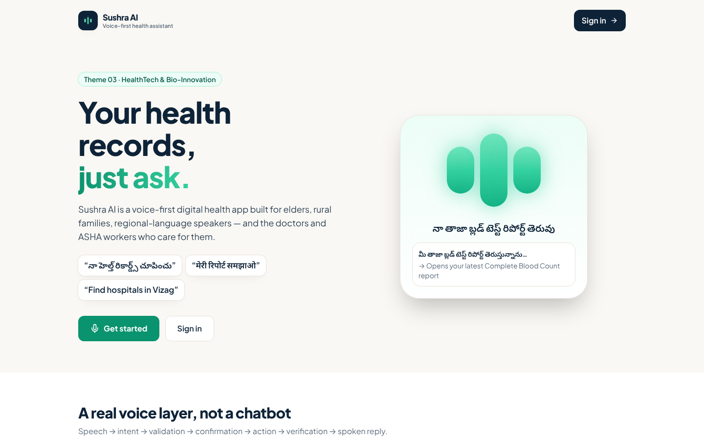
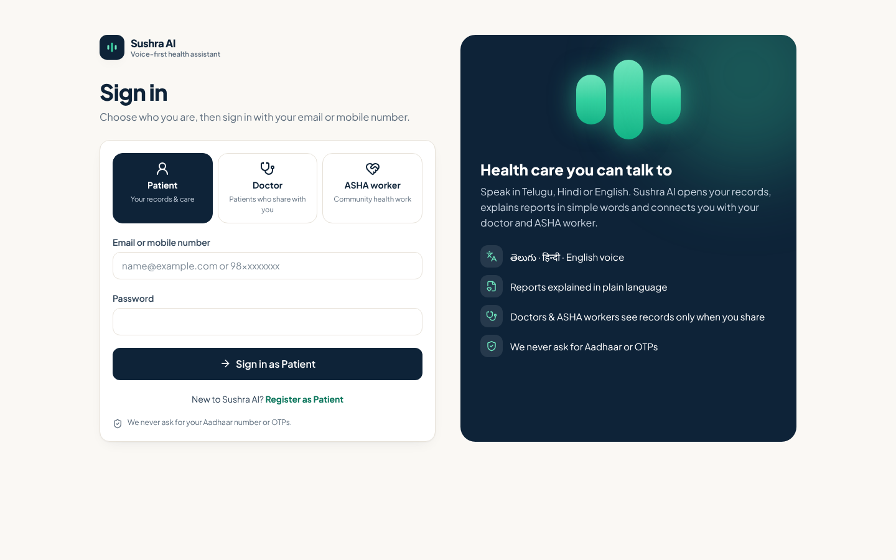
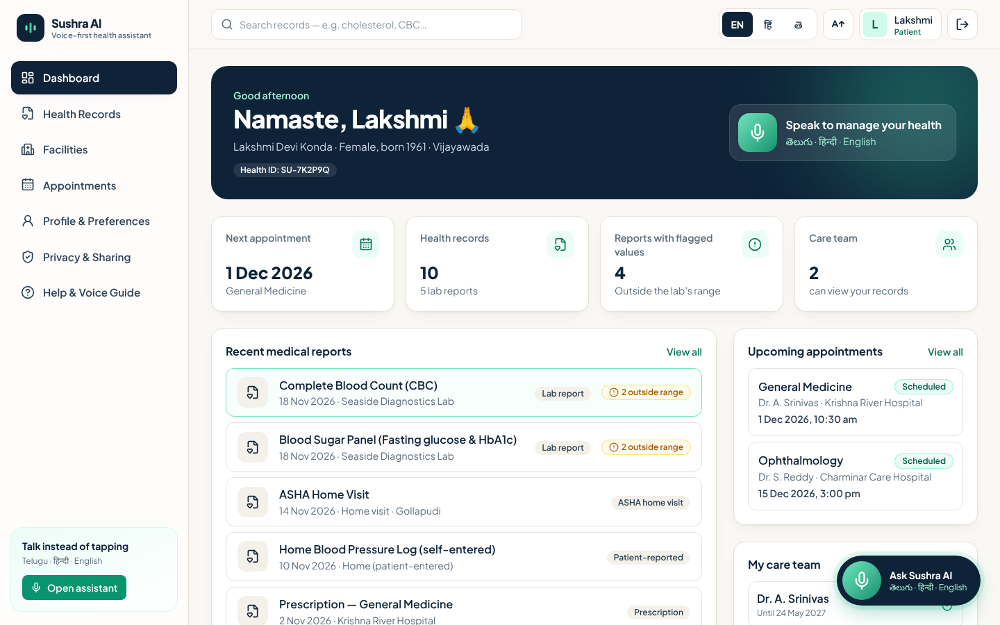
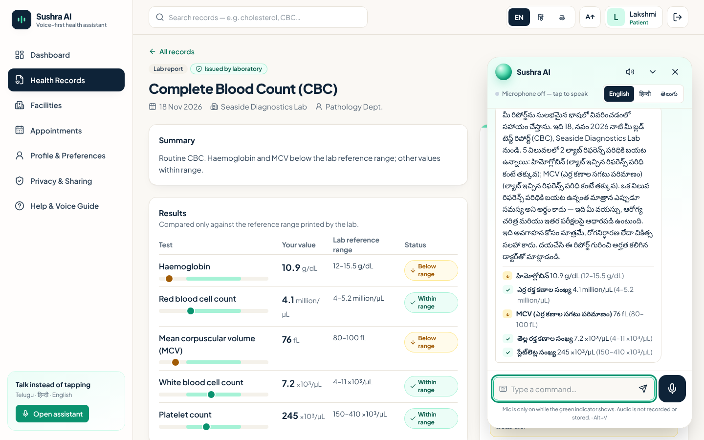
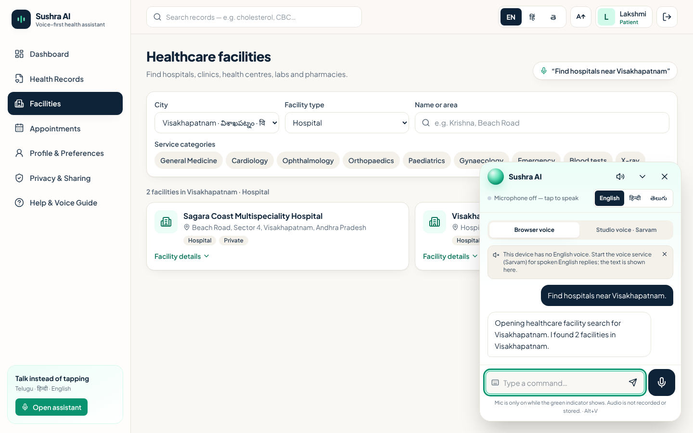
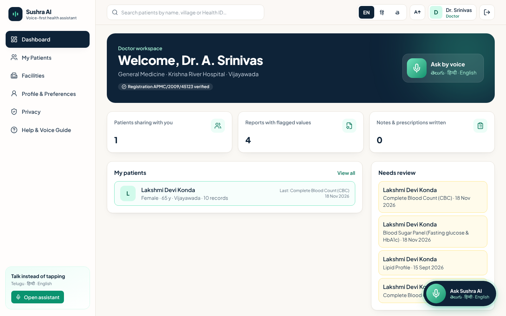
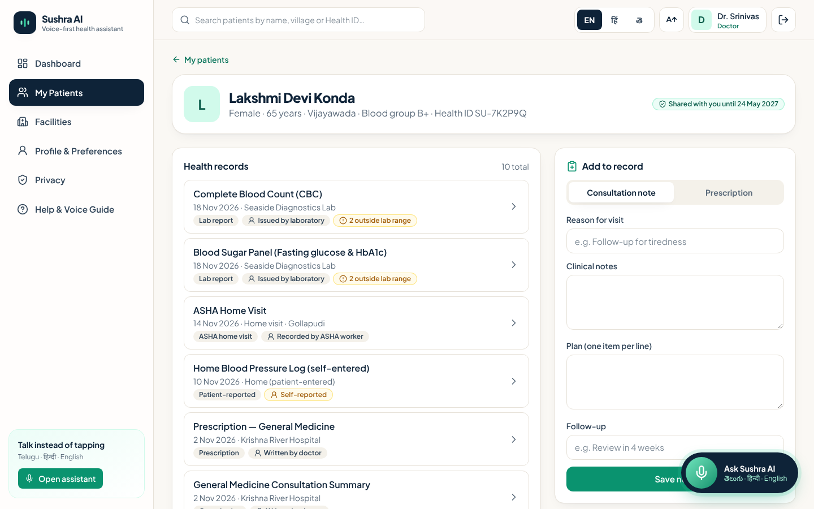
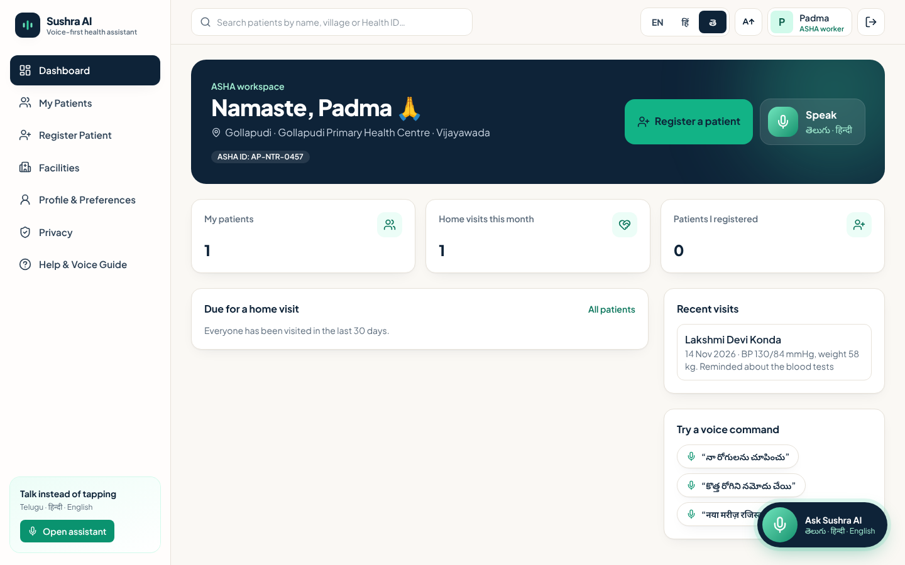
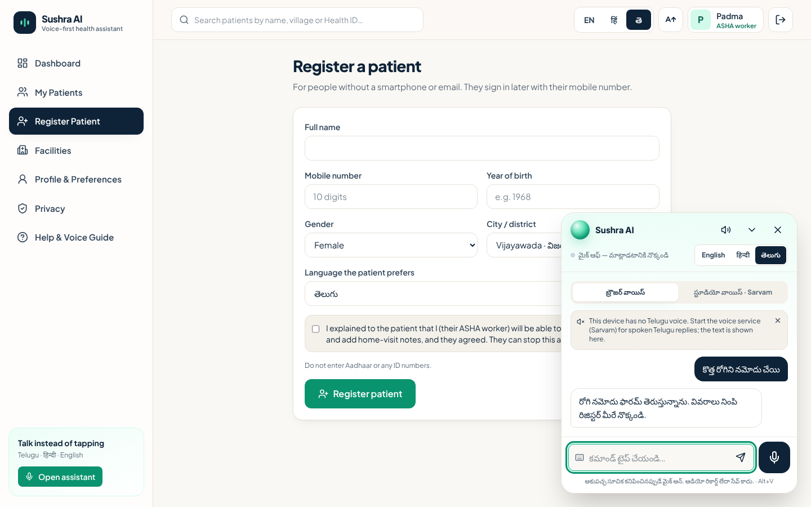
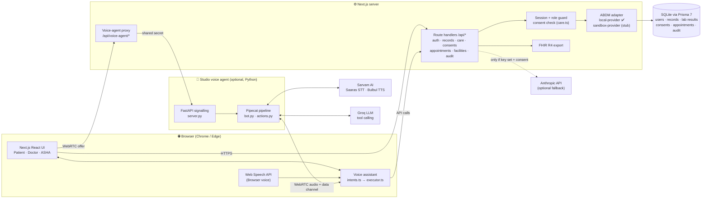

<div align="center">


# Sushra AI

**Health care you can talk to — in Telugu, Hindi and English.**

A voice-first digital health platform for **patients**, **doctors** and **ASHA workers**, inspired by India's ABDM ecosystem.

[](https://sushra-ai-6m5l.onrender.com)


**Theme 03 — HealthTech & Bio-Innovation**

[Live Demo](#-live-demo) · [Demo Logins](#-demo-login-credentials) · [Screenshots](#-screenshots) · [Run Locally](#-installation-and-setup) · [Limitations](#-implemented-features-and-current-limitations)

</div>

---

## 🌐 Live Demo

> ### ▶ Working prototype: **[https://sushra-ai-6m5l.onrender.com](https://sushra-ai-6m5l.onrender.com)**
>
> This is the deployed, working version of Sushra AI. Open it in **Chrome or Edge** (for voice input) and sign in with any [demo account below](#-demo-login-credentials).

---

## 💡 About Sushra AI

**Problem:** Elderly, rural and regional-language users struggle to read medical reports and use English-first health apps, and their doctors and ASHA workers lack a simple, consent-based way to see the same records.
**Solution:** Sushra AI lets anyone run the app by *speaking* in Telugu, Hindi or English — it opens records, explains reports against the lab's own reference ranges, fills forms only after confirmation, and shares records with a doctor or ASHA worker only while the patient's consent is active.

> Independent project, not affiliated with NHA/ABDM/ABHA. All seeded accounts, records and facilities are **fictional sample data**.

---

## 🧭 Platform Overview

| 🧑‍🦳 Patient | 🩺 Doctor | 🤝 ASHA Worker |
|---|---|---|
| Sees their own health records, lab results, appointments and care team. Asks the assistant to open or explain a report in their language, find facilities, and update preferences. Decides who can see their records and for how long. | Sees only the patients who have shared records with them. Opens reports, gets explanations in Hindi/Telugu/English, and writes consultation notes and prescriptions into the patient's record. | Supports patients in the community. Registers patients who have no email or smartphone (with their consent), records home visits (BP, weight, sugar, notes) and tracks who is due for a visit. |

All three roles use the **same voice assistant** (bottom-right button, or **Alt + V**) and the same safety rules: data changes need confirmation, and credentials such as Aadhaar numbers, OTPs and passwords are refused.

---

## ✨ Key Features

### 🧑‍🦳 Patient
- **Dashboard** — next appointment, record count, reports with flagged values, care team, and a haemoglobin-over-time chart.
- **Health records** — lab reports, prescriptions, consultations, imaging, ASHA home visits and self-reported notes, with search.
- **Report view** — each value compared **only** with the reference range printed by the lab (below / within / above).
- **Plain-language explanations** in Telugu, Hindi or English (grounded in the record; never diagnoses or prescribes).
- **Facility finder** — filter hospitals, clinics, PHCs, labs and pharmacies by city, type and service.
- **Appointment requests** — the assistant can fill the form, but only the user can submit it.
- **Privacy & sharing** — share records with a doctor or ASHA worker for 1–12 months, stop sharing at any time, see recent account activity.
- **Preferences** — language, city, text size, spoken replies and high-contrast mode (changeable by voice, with confirmation).
- **FHIR export** — download any record as an HL7 FHIR R4 Bundle (JSON).

### 🩺 Doctor
- **Doctor workspace** — patients sharing with you, reports with flagged values, and a "needs review" list.
- **Consent-based patient list** — a patient appears only while their sharing consent is active; revoking or expiry removes access immediately.
- **Patient record view** with report explanations in any of the three languages.
- **Consultation notes** (reason, clinical notes, plan, follow-up) and **prescriptions** (medicine, dose, frequency, duration) saved to the patient's record.
- Newly registered doctors show **"verification pending"** for their registration number.

### 🤝 ASHA Worker
- **ASHA workspace** — my patients, home visits this month, patients I registered, and who is due for a home visit.
- **Assisted registration** — register a patient with just a mobile number (no email), after recording the patient's consent. A temporary password is generated for the patient's first sign-in.
- **Home visits** — record BP, weight, blood sugar and notes; the visit appears in the patient's own records.
- Voice commands in Telugu and Hindi, e.g. *"కొత్త రోగిని నమోదు చేయి"* (register a new patient).

### 🎙️ Voice assistant (all roles)
- **Browser voice** — Web Speech API (te-IN / hi-IN / en-IN) with a deterministic trilingual intent engine. **Works with no API keys.**
- **Studio voice** — real-time WebRTC conversation through a separate Python service: **Sarvam Saaras** (speech-to-text) → **Groq** LLM with tool calling → **Sarvam Bulbul** (text-to-speech).
- Every action follows: *speech → intent → validation → confirmation → action → verification → spoken reply*. Failure is reported honestly.
- Remembers context across turns ("open my records" → "open the latest one" → "explain it in Telugu").

---

## 🔑 Demo Login Credentials

> **These are seeded demonstration accounts** created by `prisma/seed.ts`. They contain only fictional data.

<div align="center">

### Common password: `Sushra@123`

| Role | Email | Mobile (also works) |
|:---:|:---|:---:|
| 🧑‍🦳 **Patient** | `lakshmi@sushra.in` | `9000000001` |
| 🩺 **Doctor** | `dr.srinivas@sushra.in` | `9000000003` |
| 🤝 **ASHA Worker** | `padma.asha@sushra.in` | `9000000004` |

</div>

**How to log in**
1. Open the [live prototype](https://sushra-ai-6m5l.onrender.com) (or `http://localhost:3000` locally) and click **Sign in**.
2. Choose the role tab — **Patient**, **Doctor** or **ASHA worker**. The tab must match the account; picking the wrong one shows which role the account belongs to.
3. Enter the email (or mobile number) and the password `Sushra@123`, then click **Sign in as …**.

An extra seeded patient, `ravi@sushra.in` (`9000000002`), shares records with no one — useful for checking that doctors and ASHA workers cannot see unshared patients.

**Try these after signing in as the patient:** open the assistant and type or say *"Show me my latest blood test report"*, then *"Explain it in Telugu"*.

---

## 📸 Screenshots

<table>
  <tr>
    <td width="50%"><br/><sub><b>Landing page</b></sub></td>
    <td width="50%"><br/><sub><b>Role-based sign-in</b></sub></td>
  </tr>
  <tr>
    <td><br/><sub><b>Patient</b> — dashboard</sub></td>
    <td><br/><sub><b>Patient</b> — CBC report explained in Telugu by voice</sub></td>
  </tr>
  <tr>
    <td><br/><sub><b>Patient</b> — "Find hospitals near Visakhapatnam"</sub></td>
    <td><br/><sub><b>Doctor</b> — workspace</sub></td>
  </tr>
  <tr>
    <td><br/><sub><b>Doctor</b> — shared patient, notes &amp; prescriptions</sub></td>
    <td><br/><sub><b>ASHA worker</b> — workspace</sub></td>
  </tr>
  <tr>
    <td colspan="2" align="center"><br/><sub><b>ASHA worker</b> — assisted registration opened by a Telugu voice command</sub></td>
  </tr>
</table>

<sub>Screenshots were captured from the running application with the seeded demo data (Browser voice, typed commands).</sub>

---

## 🛠️ Technology Stack

| Layer | Technologies |
|---|---|
| **Frontend** | Next.js 15 (App Router) · React 19 · TypeScript · Tailwind CSS v4 · Framer Motion · Lucide icons · Noto Sans Telugu / Devanagari fonts |
| **App backend** | Next.js Route Handlers · Zod validation · HMAC-signed httpOnly session cookies · scrypt password hashing |
| **Database** | Prisma 7 ORM · SQLite (via `better-sqlite3` adapter) — schema portable to PostgreSQL |
| **Browser voice** | Web Speech API (speech recognition + synthesis) · deterministic Telugu/Hindi/English intent engine |
| **Studio voice agent** | Python · FastAPI · Uvicorn · Pipecat 1.17 · SmallWebRTC transport · Silero VAD · Sarvam AI Saaras (STT) & Bulbul (TTS) · Groq LLM with tool calling |
| **Optional LLM fallback** | Anthropic API (server-side only) for unusual phrasings and AI-worded explanations, after user consent |
| **Interoperability** | HL7 FHIR R4 Bundle export · ABDM provider interfaces (local provider + sandbox stub) |
| **Testing** | Vitest · Playwright · pytest |

---

## 🏗️ System Architecture



**How it fits together**
- The **Next.js app** serves the UI and all APIs. Every record query is scoped to the signed-in patient, or to a doctor/ASHA worker who holds an active consent from that patient (`src/server/care.ts`).
- **Browser voice** runs entirely in the browser and the Next.js app — no keys needed.
- **Studio voice** is a separate Python service. The Pipecat bot **never touches patient data**: each LLM tool call is validated in Python (`voice-agent/actions.py`), sent over the WebRTC data channel to the signed-in browser, executed by the **same** guarded executor (`src/lib/voice/executor.ts`), and the verified result is spoken back.
- The voice agent is reachable only through the authenticated Next.js proxy, protected by a shared secret.

---

## ⚙️ Installation and Setup

### Prerequisites
| Tool | Version | Needed for |
|---|---|---|
| [Node.js](https://nodejs.org/) | 20 or newer | Web app |
| [Git](https://git-scm.com/download/win) | any recent | Cloning |
| Chrome or Edge | latest | Voice input (Firefox has no speech recognition) |
| [Python](https://www.python.org/downloads/) | 3.11 or newer | *Only* for the optional Studio voice agent |

### Steps (Windows — PowerShell)

```powershell
# 1. Clone the repository
git clone https://github.com/chintagadaharshini/Sushra-Ai.git
cd Sushra-Ai

# 2. Create your local environment file
copy .env.example .env
#    Open .env and set SESSION_SECRET to any long random string

# 3. Install dependencies (also generates the Prisma client)
npm install

# 4. Create the SQLite database and load the demo data
npm run setup
```

<details>
<summary>macOS / Linux equivalents</summary>

```bash
git clone https://github.com/chintagadaharshini/Sushra-Ai.git
cd Sushra-Ai
cp .env.example .env
npm install
npm run setup
```
</details>

> **If `npm run setup` fails because your network blocks Prisma's engine download**, use the offline route instead:
> ```powershell
> node scripts/apply-migrations-offline.mjs
> npm run db:seed
> ```
> Reset the demo data at any time with `npm run db:seed`.

---

## 🔐 Environment Variables and Dependencies

Copy the provided templates — **never commit your real `.env` files** (they are already in `.gitignore`).

### Web app — `.env` (from `.env.example`)

| Variable | Required? | Purpose |
|---|---|---|
| `DATABASE_URL` | ✅ | SQLite file path. Default `file:./dev.db` |
| `SESSION_SECRET` | ✅ | Long random string used to sign session cookies |
| `DATA_MODE` | optional | `local` (default) or `abdm_sandbox` (stub — fails safely, see limitations) |
| `ABDM_BASE_URL`, `ABDM_CLIENT_ID`, `ABDM_CLIENT_SECRET` | optional | Reserved for a future ABDM sandbox integration |
| `ABDM_HIU_ID` | optional | Reserved; not read by the current code |
| `ANTHROPIC_API_KEY`, `LLM_MODEL` | optional | LLM fallback for unusual phrasings and AI-worded explanations (consent-gated, server-side only) |
| `VOICE_AGENT_URL` | optional | Studio voice agent address. Default `http://127.0.0.1:7860` |
| `VOICE_AGENT_SHARED_SECRET` | optional | Must equal the same variable in `voice-agent/.env` |
| `NEXT_PUBLIC_PIPECAT_MEDIA_MANAGER` | optional | `local` uses a WebAudio player instead of the default WebRTC device manager |

### Voice agent — `voice-agent/.env` (from `voice-agent/.env.example`)

| Variable | Required? | Purpose |
|---|---|---|
| `SARVAM_API_KEY` | ✅ | Sarvam AI key — [dashboard.sarvam.ai](https://dashboard.sarvam.ai) |
| `GROQ_API_KEY` | ✅ | Groq key — [console.groq.com/keys](https://console.groq.com/keys) |
| `VOICE_AGENT_SHARED_SECRET` | ✅ | Same value as in the web app's `.env` |
| `GROQ_MODEL` | optional | Default `openai/gpt-oss-120b` |
| `STT_MODEL`, `TTS_MODEL`, `TTS_VOICE` | optional | Defaults `saaras:v4`, `bulbul:v3`, `priya` (female voice) |
| `STUDIO_BARGE_IN` | optional | `1` lets users interrupt the assistant (use headphones). Default `0` |
| `HOST`, `PORT` | optional | Default `127.0.0.1` and `7860` |

### Dependencies
- **Web app:** declared in `package.json` (installed with `npm install`). Key packages: `next`, `react`, `@prisma/client`, `@prisma/adapter-better-sqlite3`, `better-sqlite3`, `zod`, `@pipecat-ai/client-js`, `@pipecat-ai/small-webrtc-transport`.
- **Voice agent:** declared in `voice-agent/requirements.txt` — `pipecat-ai[sarvam,groq,webrtc,silero]==1.17.0`, `fastapi`, `uvicorn`, `python-dotenv`, `pydantic`, `pytest`, `pytest-asyncio`.

---

## ▶️ Running the Application and Voice Agent

### 1. Web app (Browser voice — no API keys needed)

```powershell
npm run dev
```
Open **http://localhost:3000** and sign in with a [demo account](#-demo-login-credentials).

For a production build: `npm run build` then `npm run start`.

### 2. Studio voice agent (optional — needs Sarvam + Groq keys)

Open a **second** PowerShell window:

```powershell
cd voice-agent
python -m venv .venv
.venv\Scripts\activate
pip install -r requirements.txt
copy .env.example .env
#   Edit voice-agent\.env: add SARVAM_API_KEY, GROQ_API_KEY and a VOICE_AGENT_SHARED_SECRET
python server.py
```

The agent listens on `http://127.0.0.1:7860` and is only reachable through the Next.js app. Then add the **same** secret to the web app's `.env`:

```env
VOICE_AGENT_URL="http://127.0.0.1:7860"
VOICE_AGENT_SHARED_SECRET="<same value as voice-agent/.env>"
```

Restart `npm run dev`, open the assistant, choose **Studio voice · Sarvam**, tap the green microphone button and speak.

> If PowerShell blocks `activate`, run `Set-ExecutionPolicy -Scope Process -ExecutionPolicy Bypass` in that window first.

### 3. Tests (optional)

```powershell
npm run typecheck          # TypeScript
npm test                   # Vitest unit/integration tests
npm run e2e                # Playwright browser tests (first run: npx playwright install chromium)
cd voice-agent; pytest -q  # Python tool-validation tests
```

---

## ✅ Implemented Features and Current Limitations

### Implemented (in this repository)
- Role-based registration and sign-in for **Patient, Doctor and ASHA worker** (email or mobile + password).
- Consent-based care access with 1–12 month sharing, revoke and automatic expiry.
- Patient records, lab results vs. lab reference ranges, appointments, facility search, preferences, activity log.
- Doctor consultation notes and prescriptions; ASHA assisted registration and home visits.
- Trilingual (Telugu/Hindi/English) voice assistant: **Browser voice** (no keys) and **Studio voice** (Pipecat + Sarvam + Groq).
- Grounded report explanations in three languages; HL7 FHIR R4 export per record.
- Security: confirmation before data changes, write-field whitelists, refusal of Aadhaar/OTP/password input, audit log without transcripts.

**Verified locally on 25 Nov 2026:** `npm run typecheck` ✔ · `npm run build` ✔ · `npm test` — 112 passed · `npm run e2e` — 21 passed (1 optional audio test skipped) · `pytest` — 6 passed · all three demo logins ✔.

### Current limitations
- **ABDM / ABHA:** there is **no live ABDM connectivity**. `DATA_MODE=abdm_sandbox` switches to a stub (`src/server/abdm/sandbox-provider.ts`) that refuses safely; no ABDM endpoints are called. In-app sharing consents are not ABDM consent artefacts. See [docs/ABDM_INTEGRATION.md](docs/ABDM_INTEGRATION.md) for the plan.
- **Live Sarvam/Groq calls** were not verified in the build environment (no keys); the WebRTC transport and tool bridge were tested with a loopback bot.
- Browser voice depends on the browser's speech service (best in Chrome/Edge; none in Firefox). Telugu speech output needs a Telugu voice on the device — often missing on Windows — unless the Studio voice service is running.
- Language is selected explicitly (EN / हिं / తె); automatic language detection is not enabled.
- Doctor registration numbers are not checked against a medical council; ASHA IDs are self-declared. No OTP login, account verification or password reset.
- Appointment requests are not confirmed by any facility workflow. The facility directory is fictional.
- FHIR export uses local demo codes (not validated LOINC/SNOMED).
- SQLite is used for the demo; production would need PostgreSQL.

Full details: **[docs/KNOWN_LIMITATIONS.md](docs/KNOWN_LIMITATIONS.md)**.

---

## ⏱️ 48-Hour Hackathon Feasibility and Proposed Enhancements

> 🟡 **All three items below are planned enhancements.** They are **not implemented** in the current source code, except where a related building block is noted.

### A. Healthcare Conversational AI — *planned*
Today the LLMs (Groq in Studio voice, optional Anthropic fallback) only map speech to **validated app actions**; there is no open-ended health conversation.

| | |
|---|---|
| **Proposed implementation** | Add a "health questions" mode that sends the user's question to an existing pretrained LLM with a healthcare system prompt, retrieval over a small curated knowledge base (e.g. government health guidance), the patient's preferred language, and strict guardrails: no diagnosis, no dosing, always "consult your doctor", emergency escalation text. Reuse the existing Sarvam STT/TTS for Telugu/Hindi speech. |
| **Suitable technologies** | Groq or Anthropic API (already wired), a lightweight vector store (e.g. SQLite + embeddings or Chroma), Sarvam Saaras/Bulbul, Zod/Pydantic output validation. |
| **48-hour feasibility** | ✅ Realistic — prompting + retrieval over a small curated corpus on top of an existing API. **No foundation model is trained from scratch.** |
| **Dependencies & challenges** | API keys and rate limits; curating trustworthy content; hallucination risk; quality of Telugu medical terms; medical-safety review. |
| **Fallback** | Answer only from a fixed FAQ set of reviewed answers in three languages; otherwise say "please ask your doctor or ASHA worker". |

### B. Daily Patient Health Tracker — *planned*
Building blocks that exist: a `PATIENT_NOTE` (self-reported) record type, ASHA home-visit vitals, a seeded self-entered BP log, and a haemoglobin trend chart. **Patients cannot yet add their own daily entries.**

| | |
|---|---|
| **Proposed implementation** | New `DailyHealthEntry` table (date, BP, sugar, weight, symptoms, mood/notes) linked to the patient; patient form and voice command ("record my BP 130 by 85") with confirmation; date-wise history and trend charts; doctors see entries **only** under an active patient consent (reusing the existing consent check). |
| **Suitable technologies** | Prisma migration, Next.js route handler + Zod, existing `TrendChart` component, existing voice executor and confirmation flow. |
| **48-hour feasibility** | ✅ Realistic — fits the current data model, consent logic and UI patterns. |
| **Dependencies & challenges** | Input validation for vitals, avoiding duplicate entries per day, keeping the voice flow safe, clearly labelling data as patient-reported. |
| **Fallback** | Store entries as `PATIENT_NOTE` health records (already supported type) and show a simple date-wise list instead of charts. |

### C. Prescription Intelligence — *planned*
Today doctors type prescriptions manually (medicine, dose, frequency, duration). **No OCR or image processing exists.**

| | |
|---|---|
| **Proposed implementation** | Upload a photo of a printed or handwritten prescription → OCR / vision model extracts text → structure into medicine name, dose, frequency, duration and instructions → show each field with a **confidence indicator** → the record stays **"unverified"** until a doctor reviews and confirms it. |
| **Suitable technologies** | A vision-capable LLM API or OCR engine (e.g. Tesseract for printed text), Zod schema for structured output, the existing prescription form for doctor review. |
| **48-hour feasibility** | 🟠 Partially realistic — printed prescriptions are achievable; handwritten accuracy is uncertain and must be shown honestly through confidence scores. |
| **Dependencies & challenges** | Handwriting quality, brand vs. generic medicine names, image privacy, API cost. **The system never prescribes medicines or makes clinical decisions on its own.** |
| **Fallback** | Extract text only, pre-fill the existing prescription form, and require the doctor to correct and confirm every field. |

---

## 🗺️ Future Roadmap

- [ ] **ABDM sandbox integration** — register as an HIU, implement consent requests and FHIR data transfer in `sandbox-provider.ts`.
- [ ] **ABHA-based sign-in** and OTP verification.
- [ ] Healthcare Conversational AI, Daily Health Tracker and Prescription Intelligence (above).
- [ ] Automatic language detection and more Indian languages.
- [ ] Facility workflow to confirm appointment requests; real facility directory (Health Facility Registry).
- [ ] Doctor registration verification; password reset.
- [ ] PostgreSQL deployment and scale-out for the voice agent (TURN servers, multiple workers).
- [ ] Validated LOINC/SNOMED codes and ABDM FHIR profile conformance.

---

## 👥 Team and Acknowledgements

**Team**
- **Chintagada Harshini** — [@chintagadaharshini](https://github.com/chintagadaharshini)
<!-- Add the other team members here (name — role — GitHub link). -->

**Built with** — [Pipecat](https://github.com/pipecat-ai/pipecat) (real-time voice pipeline) · [Sarvam AI](https://www.sarvam.ai/) (Saaras speech-to-text and Bulbul text-to-speech) · [Groq](https://groq.com/) (LLM inference) · [Next.js](https://nextjs.org/) · [Prisma](https://www.prisma.io/).

**Inspired by** India's Ayushman Bharat Digital Mission ([abdm.gov.in](https://abdm.gov.in)). Sushra AI is an independent project and is not affiliated with NHA, ABDM or ABHA.

<div align="center">
<sub>Made for Theme 03 — HealthTech &amp; Bio-Innovation</sub>
</div>
